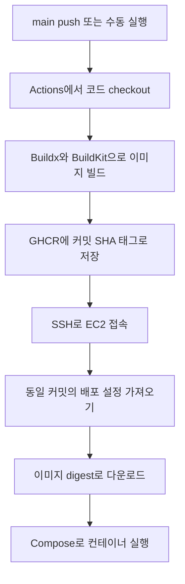

# 백엔드 배포 파이프라인

확인일: 2026-10-14. 이 문서는 저장소 설정을 설명합니다. 운영 서버에는 변경 사항을 main에 반영한 뒤 새 워크플로를 실행해야 적용됩니다.

## 배포 흐름

GitHub Actions가 백엔드 Docker 이미지를 빌드하고 GHCR(GitHub Container Registry)에 저장합니다. EC2는 SSH로 전달받은 이미지 주소를 이용해 다운로드하고 실행합니다. 패키지 설치와 코드 빌드는 EC2에서 수행하지 않습니다.



- Actions runner: `ubuntu-latest`. `npm install`, `npm run build`, 이미지 생성이 수행됩니다.
- GHCR: 완성된 이미지를 보관합니다. 이미지 이름은 `ghcr.io/chhezue/moijang-backend`입니다.
- EC2: `linux/amd64` 이미지를 받아 기존 백엔드·Redis 서비스를 실행합니다.
- SSH: Actions에서 EC2로 접속해 배포 명령을 실행하는 통신 방식입니다.

## 설정 파일과 확인 위치

| 설정                                                          | 역할                            | 확인 위치                                                              |
| ------------------------------------------------------------- | ------------------------------- | ---------------------------------------------------------------------- |
| [deploy-backend.yml](../.github/workflows/deploy-backend.yml) | 빌드·업로드·SSH 배포            | GitHub Code → `.github/workflows`                                      |
| [Dockerfile](../backend/Dockerfile)                           | 이미지 빌드 과정                | GitHub Code → `backend`                                                |
| [docker-compose.prod.yml](../backend/docker-compose.prod.yml) | 운영 이미지 다운로드·실행       | GitHub Code → `backend`                                                |
| [docker-compose.yml](../backend/docker-compose.yml)           | 직접 빌드하는 로컬 Compose 설정 | GitHub Code → `backend`                                                |
| [.dockerignore](../backend/.dockerignore)                     | 빌드 입력 제외 파일             | GitHub Code → `backend`                                                |
| SSH Secrets                                                   | EC2 인증 정보                   | Settings → Secrets and variables → Actions                             |
| 이미지 및 접근 권한                                           | GHCR 패키지                     | GitHub 계정/저장소의 Packages                                          |
| 앱 환경변수                                                   | 서버에 보관하는 실행 설정       | EC2 `~/Moijang/backend/.env`                                           |
| 실행 로그                                                     | 빌드·배포 결과                  | [Actions](https://github.com/chhezue/Moijang/actions) → Deploy Backend |

## 실행 조건과 작업 순서

- main push의 변경 경로에 `backend/**` 또는 `.github/workflows/deploy-backend.yml`이 포함되면 실행합니다.
- `workflow_dispatch`로 수동 실행할 수 있습니다. 실행 브랜치는 main이어야 합니다.
- PR을 열기만 하거나 프론트 파일만 변경하면 실행되지 않습니다.
- 동시 실행 그룹 `deploy-backend-production`으로 배포 워크플로를 직렬화합니다. 진행 중인 배포는 새 push로 취소하지 않습니다. 대기 중인 실행은 더 최신 실행으로 대체될 수 있습니다.
- `build` 작업 성공 후에만 `deploy` 작업이 시작됩니다.

## Actions에서 이미지 빌드

1. 실행 대상 커밋을 checkout합니다.
2. Buildx를 준비하고 자동 발급된 `GITHUB_TOKEN`으로 GHCR에 로그인합니다.
3. `backend`를 빌드 컨텍스트로 사용해 `linux/amd64` 이미지를 만듭니다.
4. 이미지에 커밋 SHA 태그와 소스 저장소·커밋 라벨을 붙여 GHCR에 업로드합니다.
5. 업로드 결과의 digest를 배포 작업에 전달합니다. digest는 이미지 내용의 식별값이며, 태그가 바뀌어도 배포할 이미지를 특정합니다.

Dockerfile은 Node.js 20 Alpine에서 패키지 설치, 소스 복사, Nest 빌드를 수행합니다. `dist`는 TypeScript 소스를 변환한 실행용 JavaScript입니다. 실행용 이미지에는 `dist`와 `node_modules`를 복사하고 `node dist/main`으로 시작합니다.

BuildKit 레이어 캐시는 GitHub Actions 캐시(`type=gha`, scope `backend`)에 보관합니다. 패키지 설정과 이전 레이어가 같고 캐시가 남아 있으면 설치 결과를 재사용합니다. `.env*`, `node_modules`, `dist`, `*.log`는 빌드 입력에서 제외합니다.

## 인증과 서버 전제 조건

| 값                | 용도                                                            |
| ----------------- | --------------------------------------------------------------- |
| `SSH_HOST`        | EC2 주소                                                        |
| `SSH_USER`        | EC2 로그인 계정                                                 |
| `SSH_PRIVATE_KEY` | SSH 접속용 개인 키                                              |
| `GITHUB_TOKEN`    | Actions가 자동 발급하는 GHCR 인증 토큰. 별도 Secret 등록 불필요 |

빌드 작업의 토큰 권한은 `contents: read`, `packages: write`이고, 배포 작업은 `contents: read`, `packages: read`입니다. GHCR 패키지를 공개로 바꿀 필요는 없습니다. 기존 동명 패키지가 있다면 패키지 설정에서 이 저장소의 Actions 접근 권한을 확인해야 합니다.

배포 작업의 토큰은 SSH 환경변수로 EC2에 전달하고 `--password-stdin`으로 로그인합니다. Docker 인증 파일은 임시 디렉터리에 저장하고 SSH 스크립트 종료 시 제거합니다. 개인 키·토큰·`.env` 실제 값은 문서나 로그에 기록하지 않습니다.

EC2에는 Python 3, Git, Docker, Docker Compose, `~/Moijang` 체크아웃과 `backend/.env`가 필요합니다. SSH 계정은 Git fetch 및 Docker 실행 권한이 있어야 하고, 서버에서 GHCR에 접근할 수 있어야 합니다. Compose는 `up --wait --wait-timeout`을 지원해야 합니다. EC2에 Buildx를 설치할 필요는 없습니다.

## EC2에서 실행하는 배포

워크플로는 실행 커밋 `DEPLOY_SHA`를 fetch하고 `git reset --hard`로 맞춥니다. Git 관리 파일의 서버 직접 수정은 덮어써질 수 있습니다. 이미지와 Compose 설정은 같은 커밋에 대응합니다.

인증 후 핵심 실행 명령은 다음과 같습니다. `BACKEND_IMAGE`는 워크플로가 `ghcr.io/…@sha256:…` 형식으로 전달합니다.

```bash
docker builder prune -f --filter "until=72h"
PREVIOUS_IMAGE=$(docker container inspect --format '{{.Image}}' moijang-backend 2>/dev/null || true)
docker compose -p backend -f docker-compose.prod.yml pull
docker compose -p backend -f docker-compose.prod.yml up -d --no-build --wait --wait-timeout 120
docker compose -p backend -f docker-compose.prod.yml ps
python3 script/retain-deploy-images.py "${BACKEND_IMAGE%@*}" "$BACKEND_IMAGE" "$PREVIOUS_IMAGE" "$HOME/.local/state/moijang/deploy-images.json"
```

- 운영 Compose에는 `build` 항목이 없습니다. `--no-build`로 서버 빌드도 금지합니다.
- 이미지 다운로드가 성공한 후 컨테이너를 갱신합니다.
- 프로젝트 이름을 `backend`로 고정해 기존 Compose 배포의 서비스와 네트워크를 이어서 사용합니다.
- `BACKEND_IMAGE`가 없으면 설정 해석 단계에서 실패합니다. 수동 운영 명령에도 동일 변수가 필요합니다.
- 배포 전 `moijang-backend`의 실제 이미지 ID를 `PREVIOUS_IMAGE`에 기록합니다. Compose 실행 확인 후 [이미지 보관 스크립트](../backend/script/retain-deploy-images.py)가 현재 배포본과 이전 배포본 최대 2개를 보관합니다. 배포 이력은 EC2의 `~/.local/state/moijang/deploy-images.json`에 저장합니다. 최초 전환 시 기존 로컬 빌드 이미지도 이전 배포본으로 보관하지만, 자동 삭제 범위는 GHCR 백엔드 저장소에 속한 이미지로 제한합니다.
- 태그뿐 아니라 digest로 받은 이미지도 정리 대상으로 인식합니다. 다른 컨테이너가 참조하는 이미지(중지 상태 포함)는 추가로 보존하므로 실제 보관 개수는 3개보다 많을 수 있습니다. 강제 삭제는 사용하지 않습니다.
- 이 정책은 EC2 로컬 이미지에 적용됩니다. GHCR의 SHA 태그 및 이미지는 별도로 유지되며 자동 삭제하지 않습니다.
- `up --wait` 실패 시 보관 이력을 갱신하거나 이미지를 정리하지 않습니다. 정리 실패 시 배포 작업은 실패로 표시되지만 새 컨테이너 실행은 이미 완료됐을 수 있습니다.
- `builder prune`은 서버에 남은 72시간보다 오래된 정리 대상 빌드 캐시를 삭제합니다. Actions 빌드 캐시는 영향을 받지 않습니다.
- 이미지 정리는 해당 백엔드 저장소만 대상으로 합니다. 빌드 캐시 정리는 EC2 Docker 전체를 대상으로 합니다. 컨테이너나 볼륨 자체는 삭제하지 않습니다.

## 컨테이너 설정

| 항목       | 설정                                        |
| ---------- | ------------------------------------------- |
| 백엔드     | `moijang-backend`, EC2 3001 → 컨테이너 3001 |
| 환경변수   | 서버의 `backend/.env`에서 읽음              |
| Redis      | `moijang-redis`, `redis:7-alpine`           |
| Redis 연결 | `REDIS_URL=redis://redis:6379`              |
| 시작 순서  | 백엔드가 Redis에 `depends_on`으로 의존      |
| 재시작     | 두 서비스 모두 `restart: always`            |

현재 Compose에는 healthcheck와 명시적인 Redis 영속 볼륨 설정이 없습니다. `--wait`는 이 설정에서는 컨테이너가 실행 상태가 되는지 확인하며, 실제 API 정상 응답을 보장하지 않습니다. 자동 롤백은 포함되어 있지 않습니다.

## 실행 결과 확인

GitHub Actions → Deploy Backend에서 `build` 작업의 빌드·업로드 결과와 `deploy` 작업의 EC2 실행 결과를 각각 확인합니다. main 반영 후에는 새 실행을 사용합니다. 변경 전 실행의 재실행은 이전 워크플로를 사용할 수 있습니다.

```bash
gh run list --repo chhezue/Moijang --workflow deploy-backend.yml --limit 5
gh run watch <RUN_ID> --repo chhezue/Moijang --exit-status
gh run view <RUN_ID> --repo chhezue/Moijang --log-failed
```

AWS 볼륨·보안 그룹·프록시·TLS 상세와 프론트 배포 설정은 이 문서 범위에 포함하지 않습니다.
